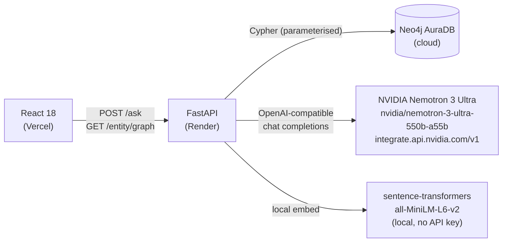
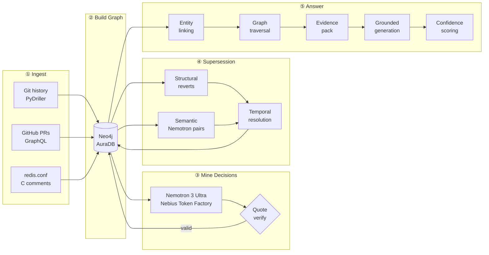
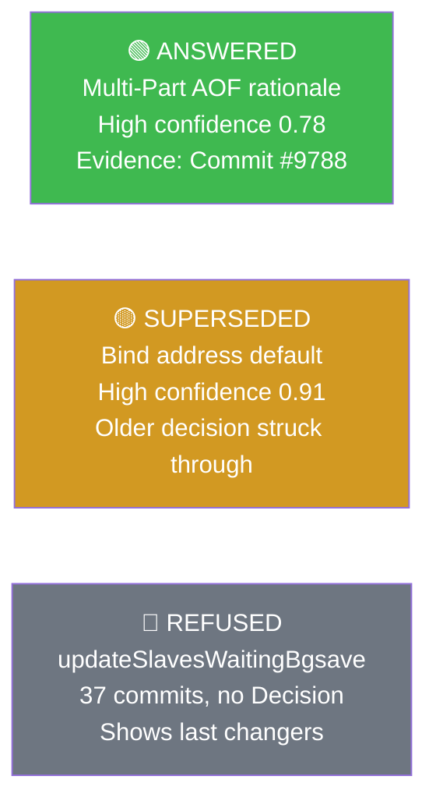

# IntentLens

> **Connect code to the decisions that shaped it.**

[](LICENSE)
[](https://devpost.com)
[](https://devpost.com)

---

**Live demo:** <!-- TODO: add Render/Fly URL after deployment -->  
**Demo video:** <!-- TODO: add YouTube URL (≤3 min) -->  
**Repo:** https://github.com/YOUR_USERNAME/intentlens

---

## The Problem

When a senior engineer leaves, the *reasoning* behind the code leaves with them.

```
Developer asks:  "Why is repl-diskless-sync set to yes by default?"
Search gives:    150 commits mentioning the setting
Wiki says:       Last updated 2019, probably wrong
LLM hallucinates: "It reduces memory pressure" (invented, uncited)
```

IntentLens gives:

```
ANSWERED  ·  High confidence  ·  Evidence: Commit ae899589 (2022-01-17)

"repl-diskless-sync was set to yes by default to align with faster
replication in modern deployments where network bandwidth is plentiful.
[E1]  The diskless approach avoids writing a temporary RDB file to disk,
reducing I/O latency during replica sync. [E1]"

Decision:  Set repl-diskless-sync to yes by default (#10092)
Decided:   2022-01-17  ·  by: oranagra
Evidence:  E1 = Commit ae899589
```

---

## How we use NVIDIA Nemotron and Nebius Token Factory

### What runs on Nemotron

**NVIDIA Nemotron 3 Ultra**, served via **Nebius Token Factory**, powers every LLM call in the IntentLens pipeline:

| Pipeline stage | What Nemotron does |
|---|---|
| **Decision mining (Pass A + Pass B)** | Extracts engineering decisions from PR/commit threads. Two independent passes with different prompts; agreement is scored as cosine similarity of the summaries. |
| **Supersession classification** | For each pair of decisions governing the same entity, classifies the relationship as `reinforces / refines / contradicts / unrelated`. The `contradicts` signal creates a `SUPERSEDES` edge in the graph. |
| **Grounded answer generation** | Produces cited JSON claims from an evidence pack. Every claim must reference a valid evidence ID from the pack; claims without citations are dropped before the answer reaches the user. |
| **Hindi/Hinglish query normalisation** | Translates non-English questions to English while preserving code identifiers, config keys, and function names exactly. |

### Why Nemotron

Supersession classification is the hardest task in the pipeline. Judging whether one engineering decision truly *overrides* another — rather than merely refining or restating it — requires reading both decisions, their rationale, and the alternatives they rejected, then making a precise semantic distinction. Nemotron's reasoning capability handles this reliably and produces the structured JSON output the pipeline requires.

### Where Nebius Token Factory helped

- **OpenAI-compatible API** — drop-in replacement for any OpenAI client; no SDK changes needed.
- **Low-latency inference** on the interactive `/ask` path, where the answer must be generated in a single round-trip.
- **Throughput for batch mining** across hundreds of PR/commit threads during the build pipeline.

> **TODO (fill in before submission):** Add measured p50/p95 latency for `/ask` calls and throughput (threads/minute) during `make build` once you have run against the live endpoint.

### Architecture



---

## Other services used

- **NVIDIA API** (`integrate.api.nvidia.com/v1`) — Nemotron 3 Ultra inference (confirmed)
- **Neo4j AuraDB** — managed cloud graph database (confirmed)
- **Render** — backend hosting (free tier)
- **Vercel** — frontend hosting (free tier)

---

## Quick Start

### Prerequisites

- Python 3.11+
- Node.js 18+
- Neo4j AuraDB free instance → [console.neo4j.io](https://console.neo4j.io)
- Nebius Token Factory API key → [nebius.ai](https://nebius.ai) (get model URL + key from dashboard)
- GitHub personal access token (public\_repo read scope)

### 1. Clone and set up

```bash
git clone https://github.com/YOUR_USERNAME/intentlens.git
cd intentlens
python -m venv .venv
.venv\Scripts\activate       # Windows
# source .venv/bin/activate  # macOS/Linux
pip install -r requirements.txt
```

### 2. Configure

```bash
cp .env.example .env
# Edit .env and fill in the REQUIRED values:
#
#   Neo4j AuraDB (from console.neo4j.io):
#     NEO4J_URI=neo4j+s://<instance-id>.databases.neo4j.io
#     NEO4J_USER=<instance-id>
#     NEO4J_PASSWORD=<your-password>
#     NEO4J_DATABASE=<instance-id>
#
#   NVIDIA API (from build.nvidia.com → Get API Key):
#     LLM_BASE_URL=https://integrate.api.nvidia.com/v1
#     LLM_API_KEY=nvapi-xxxxxxxxxxxxxxxxxxxx
#     LLM_MODEL=nvidia/nemotron-3-ultra-550b-a55b
#
#   GitHub PAT (from github.com/settings/tokens, public_repo scope):
#     GITHUB_TOKEN=ghp_xxxxxxxxxxxxxxxxxxxx
```

### 3. Set up the graph schema

```bash
python -m scripts.apply_schema
```

### 4. Run the full data pipeline

```bash
python -m scripts.ingest          # git history + GitHub PRs
python -m scripts.build_graph     # build graph + mine decisions via Nemotron
python -m scripts.run_supersession  # detect supersession relationships
```

### 5. Start the app

```bash
# Terminal 1 — backend
python -m uvicorn backend.app.main:app --host 127.0.0.1 --port 8000 --reload

# Terminal 2 — frontend
cd frontend
npm install
npm run dev
```

Open **http://localhost:5173** — or try **http://localhost:5173/ask?demo=1** for the one-click demo.

### 6. Run the Nemotron demo (dry-run, no graph write)

```bash
python -m scripts.nemotron_demo_mining --batch-size 15
# Results written to eval/nemotron_run.md
```

---

## What's new during the hackathon submission period

This project existed as an earlier build targeting a different LLM provider. The following changes were made specifically for this submission:

- **Migrated the full LLM layer to Nemotron 3 Ultra on Nebius Token Factory.** Replaced the previous provider-specific client with a clean OpenAI-compatible client (`backend/app/llm/provider.py`) that targets any OpenAI-compatible endpoint via `LLM_BASE_URL` / `LLM_API_KEY` / `LLM_MODEL` env vars.
- **Unified LLM client with exponential-backoff retries and hardened JSON parsing.** Strips `<think>…</think>` reasoning blocks, extracts the first valid JSON object from any surrounding prose, retries once with a stricter prompt on parse failure, and backs off on 429/5xx errors.
- **Nemotron-based multilingual normalisation.** Re-implemented the Hindi/Hinglish → English translation step using the new client and a prompt that preserves code identifiers and config keys exactly.
- **Live model badge in the UI.** The `/ask` endpoint now returns `llm_model` in the response; the `AnswerCard` component displays "Answered by Nemotron 3 Ultra on Nebius Token Factory" beneath every answer.
- **New `scripts/nemotron_demo_mining.py`** — a standalone script that runs decision mining and supersession classification on a small batch from the existing cache and writes results to `eval/nemotron_run.md`.
- **Licensing.** Added MIT `LICENSE` file at repo root.
- **Updated documentation and deployment guide** — README rewritten for this hackathon; `docs/DEPLOY.md` updated with Nebius Serverless Endpoints option; all references to the previous LLM provider removed.
- **All old-hackathon branding removed** from code, frontend copy, and documentation.

---

## How It Works — Five-Stage Pipeline

```
┌─────────────────────────────────────────────────────────────────────────┐
│                      IntentLens Data Pipeline                           │
└─────────────────────────────────────────────────────────────────────────┘

  ┌──────────┐    ┌──────────────┐    ┌────────────────┐
  │  Stage 1 │    │   Stage 2    │    │    Stage 3     │
  │  INGEST  │───▶│ BUILD GRAPH  │───▶│ MINE DECISIONS │
  └──────────┘    └──────────────┘    └────────────────┘
       │                 │                     │
  git log          Neo4j AuraDB          Nemotron 3 Ultra
  GitHub GraphQL   Entities, Evidence    Two-pass mining
  redis.conf       570 decisions         Quote verification
  C comments       27,249 edges          Agreement scoring
       │                 │                     │
       ▼                 ▼                     ▼
  JSONL cache      Knowledge Graph      Verified decisions
  (resumable)      (idempotent)         (with spans)
                          │
                          ▼
                  ┌────────────────┐    ┌────────────────┐
                  │    Stage 4     │    │    Stage 5     │
                  │  SUPERSESSION  │───▶│    ANSWER      │
                  └────────────────┘    └────────────────┘
                          │                     │
                  3-signal engine        GraphRAG pipeline
                  18 SUPERSEDES          Entity linking
                  40 REFINES             Evidence pack
                  14 non-active          5-factor confidence
```

### Stage 1 — Ingest

| Source | Tool | Output |
|--------|------|--------|
| Git history | PyDriller | `commits.jsonl` (1,372 commits) |
| GitHub PRs & issues | GraphQL API | `threads.jsonl` (314 PRs) |
| redis.conf comments | `ingest_docs.py` | `documents.jsonl` (63 blocks) |
| C source comments | `ingest_docs.py` | `documents.jsonl` (179 blocks, rationale-filtered) |

### Stage 2 — Build Graph

Idempotent MERGE batches push all entities into Neo4j: Commit → File/Function/ConfigKey, PullRequest → Comment → Person, Document → ConfigKey/Function/File.

### Stage 3 — Mine Decisions

Two-pass LLM mining via Nemotron. Every decision must include a verbatim quote from the source (verified before storage). Agreement scored as cosine similarity of summaries between Pass A and Pass B.

### Stage 4 — Supersession Detection

Three signals: structural (commit revert detection), semantic (Nemotron pair classification), temporal (status resolution). Result: **18 SUPERSEDES + 40 REFINES** edges.

### Stage 5 — Answer

Entity linking → graph traversal → evidence pack → grounded generation with citation verification → 5-factor confidence. Refuses with reason if no decision is found or confidence < 0.35.

---

## Knowledge Graph Schema

```
┌─────────────────────────────────────────────────────────────────────┐
│                    IntentGraph — Node Types                         │
└─────────────────────────────────────────────────────────────────────┘

                    ┌──────────────┐
                    │    Person    │
                    │  email/login │
                    └──────┬───────┘
                           │ AUTHORED
              ┌────────────▼─────────────┐
              │                          │
    ┌─────────▼──────┐         ┌─────────▼──────┐
    │    Commit      │         │  PullRequest   │
    │  sha·date·msg  │         │  number·title  │
    └─────────┬──────┘         └─────────┬──────┘
              │ MODIFIES                 │ has
              │                          │
    ┌─────────▼──────┐         ┌─────────▼──────┐
    │    Entity      │         │    Comment     │
    │  (3 subtypes)  │         │  author·body   │
    │                │         └────────────────┘
    │  ┌──────────┐  │
    │  │   File   │  │
    │  └──────────┘  │
    │  ┌──────────┐  │◄──GOVERNS──┐
    │  │ Function │  │             │
    │  └──────────┘  │   ┌─────────┴──────┐
    │  ┌──────────┐  │   │   Decision     │
    │  │ConfigKey │  │   │  title·summary │
    │  └──────────┘  │   │  rationale     │
    └────────────────┘   │  status·agree  │
                         │  embedding     │
    ┌────────────────┐   └───────┬────────┘
    │   Document     │           │ EVIDENCED_BY
    │  path·text·url │◄──────────┘
    └────────────────┘
```

### Relationship Types

| Relationship | Direction | Meaning |
|---|---|---|
| GOVERNS | Decision → Entity | This decision applies to this code entity |
| EVIDENCED_BY | Decision → Commit/PR/Comment/Doc | This source supports the decision |
| MODIFIES | Commit → Entity | This commit changed this entity |
| SUPERSEDES | Decision → Decision | Newer overrides older |
| REFINES | Decision → Decision | Newer extends without overriding |
| REVERTS | Decision → Decision | Structural git revert |
| DESCRIBES | Document → Entity | Comment block explains this entity |
| AUTHORED | Person → Commit/PR | Authorship |
| MADE_BY | Decision → Person | Person approved the decision |
| PART_OF | Commit → PullRequest | Commit belongs to this PR |
| REFERENCES | Commit/PR → Issue | `#NNN` reference |

---

## Question-Answering Pipeline

```
User question
     │
     ▼  [1] Language normalisation (Nemotron: Hindi/Hinglish → English)
     │
     ▼  [2] Entity linking (exact + full-text index)
     │
     ├── entities found → [3a] GOVERNS traversal (hop 1)
     └── not found     → [3b] Vector fallback, decision_embedding (hop 2)
                               │
                               ▼
                        [4] Supersession check → promote replacement
                               │
                               ▼
                        [5] Select governing decision, build evidence pack E1..E8
                               │
                               ▼
                        [6] Nemotron grounded generation (JSON claims, each citing E-ref)
                               │
                               ▼
                        [7] 5-factor confidence (graph-derived, never LLM self-rating)
                               │
                        score ≥ 0.35? → ANSWERED with evidence trail
                        score < 0.35? → REFUSED + last changers + person to ask
```

---

## Supersession Detection

Three signals detect when one decision overrides another:

1. **Structural** — commit messages matching `"This reverts commit SHA"` → REVERTS edge, confidence 0.95
2. **Semantic** — Nemotron classifies consecutive pairs per entity + high-cosine cross-entity pairs as `reinforces / refines / contradicts / unrelated`
3. **Temporal** — `compute_statuses()` applies precedence: `SUPERSEDED/REVERSED > UNCERTAIN > ACTIVE`

Result: 18 SUPERSEDES + 40 REFINES edges. 14 decisions marked non-ACTIVE.

---

## Confidence Scoring

```
score = 0.30 × Directness + 0.25 × Corroboration + 0.20 × Agreement
      + 0.15 × Currency   + 0.10 × Distance

Thresholds:  High ≥ 0.75  ·  Medium ≥ 0.55  ·  Low ≥ 0.35  ·  Below 0.35 → REFUSED
```

| Factor | Weight | Formula |
|---|---|---|
| Directness | 30% | 1.0 if explicit rationale stated; 0.5 if inferred |
| Corroboration | 25% | 0.4 one source · 0.7 two · 1.0 three+ source types |
| Agreement | 20% | cosine(summary_passA, summary_passB) |
| Currency | 15% | 1 − min(1, drift\_commits / 5) |
| Distance | 10% | 1 − (hops − 1) / MAX\_GRAPH\_HOPS |

---

## What's in the Graph (Redis demo)

The demo loads the **replication and persistence subsystem** of `redis/redis`:
`src/replication.c`, `src/rdb.c`, `src/aof.c`, `redis.conf`.

### Node counts

| Label | Count |
|-------|------:|
| Decision | **570** |
| Comment | 8,502 |
| Document | 2,478 |
| Commit | 1,372 |
| Person | 554 |
| PullRequest | 321 |
| Function | 282 |
| ConfigKey | 222 |
| Issue | 43 |
| File | 4 |
| **Total** | **14,348** |

### Relationship counts

| Type | Count |
|------|------:|
| AUTHORED | 10,188 |
| COMMENTED_ON | 8,502 |
| MODIFIES | 4,546 |
| REFERENCES | 1,215 |
| EVIDENCED_BY | 860 |
| MADE_BY | 779 |
| GOVERNS | 673 |
| DESCRIBES | 304 |
| REFINES | 40 |
| SUPERSEDES | 18 |
| **Total** | **27,249** |

### Three demo questions

| State | Question | Confidence |
|-------|----------|-----------|
| ✅ **ANSWERED** | What is the rationale for the Multi-Part AOF mechanism in Redis 7.0? | High (0.78) |
| ⚠ **SUPERSEDED** | Why does Redis fail to start by default when a requested bind address is not available? | High (0.91) |
| ❌ **REFUSED** | What design decision explains why `updateSlavesWaitingBgsave` uses its current implementation strategy? | No answer |

---

## Tech Stack

```
DATA LAYER
├── Neo4j AuraDB (Cypher 5)         knowledge graph + vector index
├── PyDriller                        git history traversal
└── GitHub GraphQL API               PR / issue ingestion

AI LAYER
├── NVIDIA Nemotron 3 Ultra          LLM: mining, answering, normalisation
│   via Nebius Token Factory         OpenAI-compatible, exponential-backoff retries
├── sentence-transformers            all-MiniLM-L6-v2 (384d, local — no API call)
└── Two-pass mining                  agreement scoring via cosine similarity

BACKEND
├── FastAPI + Pydantic v2            REST API (8 endpoints)
├── Parameterised Cypher only        no LLM-generated queries
└── 5-factor confidence              graph-derived, not self-rated

FRONTEND
├── React 18 + Vite                  SPA with lazy-loaded routes
├── @neo4j-nvl/react                 interactive graph explorer
├── Fraunces + Outfit fonts          evidence trail design system
└── WCAG AA contrast                 dark/light theme, 375px+
```

---

## Quick Start (recap)

See the full [Quick Start](#quick-start) section above.

---

## Project Structure

```
intentlens/
├── backend/app/
│   ├── config.py                settings (LLM_BASE_URL, LLM_API_KEY, LLM_MODEL, ...)
│   ├── models.py                Pydantic models (AnswerResponse includes llm_model)
│   ├── main.py                  FastAPI app (8 endpoints, /ready pings LLM)
│   ├── llm/provider.py          OpenAI-compatible client for Nebius Token Factory
│   ├── ingestion/               git_ingest.py, github_ingest.py, doc_ingest.py
│   ├── extraction/              entities.py, decision_miner.py
│   ├── graph/                   db.py, schema.cypher, loader.py
│   ├── reasoning/               supersession.py, confidence.py
│   └── retrieval/               cypher.py, graphrag.py
├── frontend/src/
│   ├── pages/                   Landing, Ask, Explore, How, Results, About
│   ├── components/              AnswerCard (with model badge), GraphView, ...
│   └── api.js                   reads VITE_API_BASE_URL
├── scripts/
│   ├── nemotron_demo_mining.py  Nemotron demo run → eval/nemotron_run.md
│   ├── build_graph.py           load + mine decisions
│   ├── run_supersession.py      detect supersession
│   └── run_eval.py              evaluation harness
├── eval/
│   ├── nemotron_run.md          Nemotron demo run output (generated)
│   └── gold_questions.json      45-question gold set
├── docs/
│   ├── DEPLOY.md                Render + Vercel + Nebius Serverless guide
│   └── EVALUATION_RESULTS.md   generated by make eval
├── LICENSE                      MIT 2026
└── README.md                    this file
```

---

## API Reference

| Method | Endpoint | Description |
|--------|----------|-------------|
| `POST` | `/ask` | Ask a "why" question; response includes `llm_model` field |
| `GET` | `/entity/graph?id=` | Decision neighbourhood for an entity |
| `GET` | `/entities/search?q=` | Autocomplete entity search |
| `GET` | `/stats` | Live graph counts |
| `GET` | `/eval/results` | Parsed evaluation results |
| `GET` | `/health` | Liveness probe |
| `GET` | `/ready` | Readiness probe (Neo4j + LLM ping) |

### POST /ask — example response shape

```json
{
  "status": "answered",
  "answer": "Redis uses a shared replication buffer to reduce...[E1]",
  "decision": { "title": "...", "status": "ACTIVE", "decided_on": "2021-10-25" },
  "evidence": [{ "ref": "E1", "kind": "Commit", "url": "...", "quote": "..." }],
  "confidence": { "score": 0.82, "label": "High" },
  "llm_model": "nvidia/Llama-3_1-Nemotron-Ultra-253B-v1",
  "latency_ms": 1240
}
```

---

## Evaluation

IntentLens is compared against a **vector-RAG baseline** (top-5 comments by embedding similarity, no graph traversal, no supersession check, never refuses).

| Capability | Vector-RAG | IntentLens |
|-----------|-----------|-----------|
| Answers with citations | ❌ | ✅ |
| Detects superseded decisions | ❌ | ✅ |
| Refuses unanswerable questions | ❌ (always guesses) | ✅ |
| Calibrated confidence score | ❌ | ✅ |
| Links to author / person to ask | ❌ | ✅ |
| Hindi/Hinglish questions | ❌ | ✅ |

```bash
python -m scripts.run_eval
```

---

## Design Principles

1. **Every answer carries evidence.** No sentence is shown without citing at least one evidence ID from the graph.
2. **Supersession is honoured.** A `SUPERSEDED` or `REVERSED` decision is never presented as the current answer.
3. **Refusal is a feature.** Below `REFUSAL_THRESHOLD` (0.35) or no decision within `MAX_GRAPH_HOPS`, the system refuses and says why.
4. **Confidence is computed from graph facts.** The LLM never self-rates its own answer.
5. **The LLM never writes Cypher.** All graph queries are parameterised templates in `retrieval/cypher.py`.

---

## Hackathon Submission Details

| Field | Value |
|---|---|
| Event | Nebius × NVIDIA Global AI Hackathon |
| Track | Coding and Agentic Engineering |
| LLM | NVIDIA Nemotron 3 Ultra (`nvidia/nemotron-3-ultra-550b-a55b`) |
| Inference endpoint | `https://integrate.api.nvidia.com/v1` |
| Graph DB | Neo4j AuraDB |
| Embeddings | sentence-transformers all-MiniLM-L6-v2 (local) |

---

## Feedback on Nebius Token Factory and NVIDIA Tools

> **TODO (fill in before submitting):**
> - What worked well with Nebius Token Factory (API compatibility, latency, reliability)?
> - What was rough or missing (docs, rate limits, model selection, dashboard UX)?
> - Suggestions for improvement?
> - What worked well with Nemotron 3 Ultra specifically (reasoning quality, JSON output, structured prompts)?
> - Any issues with the model (hallucinations, token limits, think-block verbosity)?

---

## Mermaid Diagrams

### Pipeline Flow



### Knowledge Graph Schema

```mermaid
erDiagram
    Person { string id; string name }
    Commit { string id; string message; string date }
    PullRequest { string id; int number; string title }
    Decision { string id; string title; string status; float agreement }
    Entity { string id; string name; string path }
    Document { string id; string path; string text }
    Comment { string id; string body; float embedding }

    Person ||--o{ Commit       : "AUTHORED"
    Person ||--o{ PullRequest  : "AUTHORED"
    Commit ||--o{ Entity       : "MODIFIES"
    Commit }o--|| PullRequest  : "PART_OF"
    Decision ||--o{ Entity     : "GOVERNS"
    Decision ||--o{ Commit     : "EVIDENCED_BY"
    Decision ||--o{ PullRequest: "EVIDENCED_BY"
    Decision ||--o{ Decision   : "SUPERSEDES"
    Decision ||--o{ Decision   : "REFINES"
    Document ||--o{ Entity     : "DESCRIBES"
    Comment  }o--|| PullRequest: "COMMENTED_ON"
```

### Three Demo Question States


